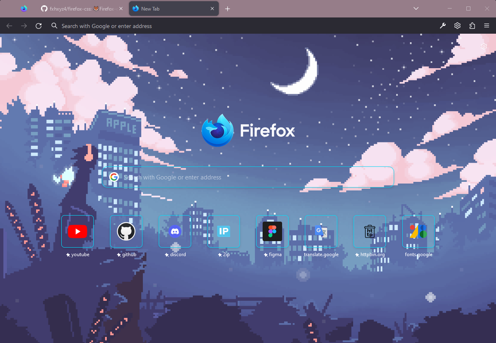

<h1 align="center">🦊 EveningFox</h1>

<p align="center">an evening theme for firefox: soft pink chrome, cyan accents and a frosted new tab over an animated background</p>

<p align="center">
  <a href="./LICENSE.md"></a>
  <a href="https://github.com/fxhxyz4/EveningFox/stargazers"></a>
</p>



## > features

- translucent pink tabs and toolbar with rounded corners
- borderless address bar, a cyan ring appears only while you type
- new tab with an animated background, frosted search field and top sites
- thin cyan scrollbars on every page
- trimmed interface: no bookmark icons, no container labels, no extra icons in the address bar, shorter context menu

<!-- prettier-ignore -->
> [!NOTE]
> the address bar dropdown (search suggestions and autocomplete) is hidden on purpose. See [customize](#-customize) to bring it back.

## > requirements

- Firefox 103 or newer on desktop (the new tab uses `backdrop-filter`). Firefox for Android does not support `userChrome.css`.
- a Firefox release that still honors `toolkit.legacyUserProfileCustomizations.stylesheets`

## > installation

1. Open `about:config`, accept the warning and set `toolkit.legacyUserProfileCustomizations.stylesheets` to `true`.
2. Open your profile folder: `about:support` > **Profile Folder** > **Open Folder** (or `about:profiles` > **Root Directory**).
3. Copy the `chrome` folder from this repository into the profile folder:

   ```sh
   git clone https://github.com/fxhxyz4/EveningFox.git
   cp -r EveningFox/chrome /path/to/your/profile/
   ```

4. Fully restart Firefox. `🦊`

Typical profile locations:

| system  | path                                                         |
| ------- | ------------------------------------------------------------ |
| Linux   | `~/.mozilla/firefox/<profile>/`                              |
| Flatpak | `~/.var/app/org.mozilla.firefox/.mozilla/firefox/<profile>/` |
| Snap    | `~/snap/firefox/common/.mozilla/firefox/<profile>/`          |
| macOS   | `~/Library/Application Support/Firefox/Profiles/<profile>/`  |
| Windows | `%APPDATA%\Mozilla\Firefox\Profiles\<profile>\`              |

## > update

```sh
cd EveningFox && git pull
cp -r chrome /path/to/your/profile/
```

This overwrites the `chrome` folder, so back up your own `background` file first if you replaced it.

## > customize

Every change needs a Firefox restart.

**Background**: replace `chrome/background/background.gif` with your own image and keep the file name. To use another format, change the
`url(./background/background.gif)` line in `userContent.css` (gif, png, jpg, webp and svg work, video does not). The bundled gif is 31
frames at 1920×1080, so a static image is lighter on weak machines and laptop batteries.

**Colors**: the palette lives in the `:root` block at the top of each file.

| variable         | file              | what it controls                             |
| ---------------- | ----------------- | -------------------------------------------- |
| `--ef-pink`      | `userChrome.css`  | selected tab and toolbar                     |
| `--ef-pink-soft` | `userChrome.css`  | hovered tab and toolbar buttons              |
| `--ef-accent`    | both              | cyan accent: focus ring, borders, scrollbars |
| `--ef-select`    | `userChrome.css`  | "search for selection" menu item             |
| `--ef-radius`    | both              | corner radius                                |
| `--ef-glass`     | `userContent.css` | frosted tint of the new tab blocks           |
| `--ef-glow`      | `userContent.css` | hover glow of top sites                      |

**Bring back what the theme hides**: delete the matching rule.

- address bar suggestions: the `.urlbarView` rule in `userChrome.css`
- bookmark icons: the `.bookmark-item .toolbarbutton-icon` rule
- context menu entries: remove their ids from the last rule in `userChrome.css`
- thin scrollbars on websites: the two `scrollbar-*` lines in `:root` of `userContent.css`

## > troubleshooting

- **nothing changed**: check that the preference is `true`, the folder is named exactly `chrome` and sits directly in the profile folder,
  and restart Firefox completely.
- **new tab looks default**: the theme only styles `about:home`, `about:newtab` and `about:privatebrowsing`. A custom new tab extension or a
  custom homepage will not be styled.
- **background is missing**: the file must be `chrome/background/background.gif` next to `userContent.css`.
- **something broke after a Firefox update**: the new tab selectors depend on Firefox internals and can be renamed between releases.
  [Open an issue](https://github.com/fxhxyz4/EveningFox/issues) with your Firefox version.

## > structure

```
chrome/
├── userChrome.css       browser interface: tabs, toolbar, address bar, menus
├── userContent.css      new tab page and scrollbars on websites
└── background/
    └── background.gif   new tab background
```

## > uninstall

Delete the `chrome` folder from your profile folder and restart Firefox. You can also set
`toolkit.legacyUserProfileCustomizations.stylesheets` back to `false`.

## > more questions?

- [write in issues](https://github.com/fxhxyz4/EveningFox/issues)

## > license

[GNU GPL v3](./LICENSE.md)
